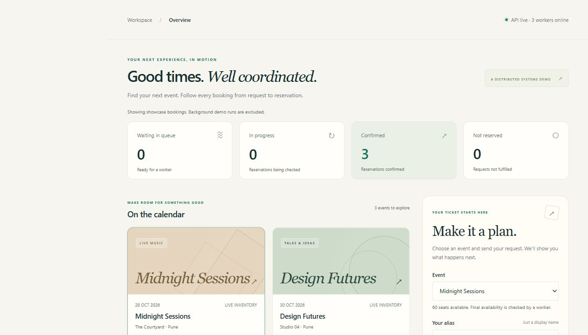
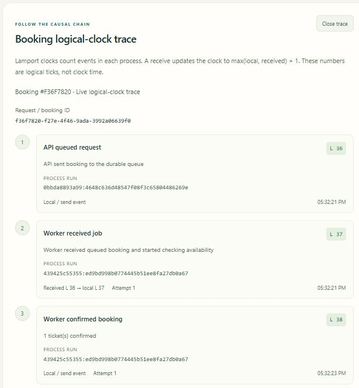
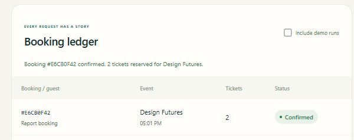
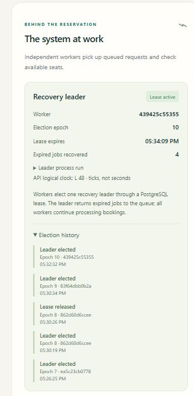
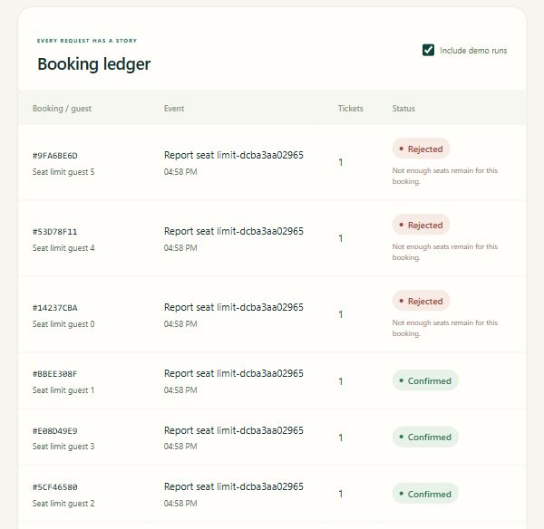

# TicketFlow

Get this version with logical clocks, leader election and the local **Stop TicketFlow** button:

```powershell
git clone --branch feature/shutdown-button https://github.com/parth-darandale/ticketflow.git
cd ticketflow
```

TicketFlow is a local distributed ticket-booking demonstration. A browser submits booking requests to an HTTP API; independent worker processes consume a durable PostgreSQL queue and reserve seats without overselling. Docker Compose starts the API, PostgreSQL and three worker containers on one PC.

There are no actual payments, payment-provider integrations or production ticket sales.

## Run on Windows

Install Docker Desktop with Docker Compose v2, select Linux containers, and wait until the Docker engine is running. The first build needs internet to download images and Python dependencies.

Double-click **Start-App.cmd**. It builds the images, starts the database, API and three workers, waits for container health, checks the HTTP health endpoint, and opens [http://127.0.0.1:8088](http://127.0.0.1:8088). No host Python installation is required to run the app.

Double-click **Stop-App.cmd** to stop the containers. The named PostgreSQL volume preserves events and bookings. After a reboot, start Docker Desktop and double-click **Start-App.cmd** again.

The dashboard's **Stop TicketFlow** button stops only this application's API, workers and database after confirmation. Saved bookings remain in the database volume. Restart with **Start-App.cmd**. The Windows launcher starts a small hidden shutdown controller; it accepts a matching-session file request and runs only `docker compose -p ticketflow down`, without deleting volumes. It does not shut down the PC or Docker Desktop. Controller files and logs are local to the ignored `.runtime/control/` directory.

Start the application using **Start-App.cmd** when you want the browser shutdown button. Starting with Docker Compose alone leaves that control unavailable when no fresh Windows controller is running; **Stop-App.cmd** continues to work.

From PowerShell in this folder:

```powershell
.\Start-App.cmd -NoBrowser
.\Start-App.cmd -Workers 1
.\Start-App.cmd -Workers 3
.\Stop-App.cmd
```

The launchers locate the project relative to themselves, so Explorer shortcuts work from any working directory. They use the Compose project `ticketflow`. Starting again updates the same project and adjusts the worker count.

To use a different HTTP port, copy `.env.example` to `.env` and change `PORT`, then start again. The launcher opens the resolved port. The API is bound to the local PC's loopback interface. Interactive API documentation is at `/docs`; health is at `/api/health`.

Equivalent Docker commands are:

```powershell
docker compose up --build --scale worker=3 -d --wait --wait-timeout 120
docker compose ps
docker compose logs --tail 80
docker compose down
```

`docker compose down` preserves the database. Do not add `-v` if you want to keep bookings.

## What makes this distributed

```text
Browser ---> HTTP API ---> PostgreSQL
                            | durable booking queue + inventory
                            +--- Worker 1
                            +--- Worker 2
                            +--- Worker 3
```

The API and workers are separate processes that communicate through PostgreSQL. Workers can run concurrently and can be scaled or restarted independently of the browser and API. PostgreSQL provides one shared durable source of truth.

1. The API records a booking as `pending`. A UUID `Idempotency-Key` makes a retry return the same booking; reusing the key with different request data returns HTTP 409.
2. A worker claims a pending or expired job using a row lock with `FOR UPDATE SKIP LOCKED`. Other workers skip that locked row rather than claiming it simultaneously.
3. A claimed booking becomes `processing`, with a 12-second lease renewed every 2 seconds. If a worker disappears, the elected recovery leader returns its expired job to `pending`, and a free worker claims it again.
4. A fencing token identifies the current claim. A worker whose claim was superseded cannot finalize the booking using its old token.
5. An atomic inventory update reserves seats only when `available >= quantity`. The seat update and terminal booking state commit in the same database transaction. The outcome is `confirmed` or `rejected` when inventory is insufficient.

This is durable queue delivery with retries and guarded finalization. It does not claim exactly-once execution: a job can be attempted more than once, while the transaction and ownership checks prevent a repeated reservation.

## Logical clocks and leader election

Each API and worker process has its own thread-safe Lamport clock and unique process-run ID. A booking carries its logical timestamp through the durable queue. Receivers apply `max(local, received) + 1`; local/send events increment their process clock. Choose **View trace** beside a booking to see API queueing, worker receipt, completion and API observation. A recovered job also shows the leader's recovery event and replacement worker's receipt. Logical ticks are separate from wall-clock timestamps and elapsed-time measurements. Counters alone do not prove causality between unrelated requests. Historical rows retain unknown timestamps rather than fabricated traces.

Workers contend for a PostgreSQL-backed **8-second leader lease**, renewed every 2 seconds. The elected leader recovers expired booking claims; every worker still processes normal pending jobs. A replacement election advances the epoch. Recovery locks and validates the current lease owner and epoch in the same transaction as requeueing, so an old leader cannot recover jobs using a superseded epoch. The dashboard shows the current leader, election history and last-reported process clocks.

This is database-mediated lease election, not the Bully/Ring algorithms or Raft/Paxos consensus. PostgreSQL remains the coordination authority. See [the syllabus mapping and protocol](docs/SYLLABUS.md).

```powershell
python -m unittest tests.test_clock tests.test_verify_syllabus -v
python -m unittest tests.test_integration tests.test_trace -v
docker compose exec -T api python -m unittest tests.test_election -v
python scripts/verify_syllabus.py --output artifacts/syllabus.json
```

The last command performs a controlled failure of the currently elected worker while it owns an isolated booking, verifies another leader with a higher epoch, checks causal recovery and one inventory debit, then restores three healthy workers. It pauses only the identified TicketFlow followers during setup. Run it when no other experiment is changing worker counts.

## Verify and demonstrate

See [the demonstration guide](docs/DEMO.md) for repeatable overselling, idempotency, recovery and worker-scaling demonstrations.

With the app running and Python 3.10 or newer on the host:

```powershell
python scripts/verify_system.py
python scripts/verify_system.py --recovery
python scripts/benchmark.py --orders 12 --output artifacts/benchmark.json
```

The benchmark compares one worker with three workers and saves measured results to `artifacts/benchmark.json`. The recovery and benchmark scripts restore the normal three-worker configuration. Their fixtures are separate test events; they add records to the local demonstration database.

## Database invariant tests

The four database-level invariant tests run inside the API container, with the queue drained and workers paused so they cannot consume the test fixtures:

```powershell
docker compose stop worker
docker compose exec -T api python -m unittest tests.test_queue -v
docker compose up -d --scale worker=3 --wait
```

They check expired and superseded claims, duplicate finalization, a stale heartbeat, and rollback of inventory and booking status after an injected transaction failure. Always restore workers after this test, including when investigating a failure. Dashboard test records are excluded by default; **Include demo runs** displays them alongside showcase bookings.

## API overview

| Endpoint | Purpose |
| --- | --- |
| `GET /api/health` | API/database health |
| `GET /api/dashboard` | Events, bookings, workers, metrics and activity |
| `POST /api/bookings` | Queue a booking; requires a UUID `Idempotency-Key` header |
| `GET /api/bookings/{id}` | Inspect a booking's state |
| `GET /api/bookings/{id}/trace` | Per-booking Lamport events and a read-only API observation |
| `GET /api/coordination` | Current leader lease, epoch, process clock and election history |
| `GET /api/events/{id}` | Inspect inventory, confirmed tickets and status counts |
| `POST /api/demo/events` | Create a separate, hidden demonstration event |
| `GET /api/system/control` | Launcher-bound local shutdown-control availability; it exposes no control session token |
| `POST /api/system/shutdown` | Same-origin local confirmation signal only; the Windows controller stops the fixed TicketFlow Compose project |

A booking body contains `event_id`, `customer_name` and `quantity` from 1 to 6. A demo event body contains `title` and `total_seats`. Use `/docs` for the full request and response schemas.

## Problem statement and viva explanation

**Problem:** concurrent ticket requests can oversell a limited inventory, and a worker crash can leave accepted work unfinished.

**Approach:** accept requests into a durable queue, distribute processing across independent workers, claim jobs with database locks and leases, reject stale owners with fencing tokens, and commit seat changes with the booking result in one transaction.

**Demonstration:** submit more requests than available seats, confirm that inventory never becomes negative, retry an idempotent request, stop a processing worker and observe recovery, then compare the measured completion time with one and three workers.

## Limits

This is a single Docker host demonstration. Multiple worker containers demonstrate concurrent distributed processes; they do not provide resilience against failure of the PC. PostgreSQL is a single point of failure, with no database replication, automatic failover or cross-region operation. Durability depends on retaining the local volume and underlying disk; backups are not automated.

There is no authentication, authorization, payment processing, production abuse protection or external message broker. The demo-event endpoint is intended for local testing. Scaling workers cannot remove database or API bottlenecks, and measured speedup depends on the workload and machine. Docker Compose is sufficient to reproduce this project; Kubernetes is not required.

## Technical references

This repository contains the application and measured technical evidence. Student report submitted separately.

- [PostgreSQL SELECT locking clauses](https://www.postgresql.org/docs/17/sql-select.html): `SKIP LOCKED` permits multiple consumers to work through a queue without waiting on the same rows.
- [Docker Compose startup order](https://docs.docker.com/compose/how-tos/startup-order/): dependency health checks gate service startup.
- [Docker Compose scaling](https://docs.docker.com/reference/cli/docker/compose/scale/): worker replicas are independent containers.
- [Psycopg transaction management](https://www.psycopg.org/psycopg3/docs/basic/transactions.html): connection context managers commit successful blocks and roll back failed ones.

Public application source: https://github.com/parth-darandale/ticketflow on branch `main`. The public source history excludes the personal assignment PDF, college logo and student report generator.

## Working application evidence

These screenshots show the running Docker Compose application. The recorded abrupt SIGKILL experiment elected a replacement recovery leader at epoch **10**, up from **9**, completed the booking on attempt **2** in **14.625 seconds**, and reserved its seat once. See the full [logical-clock and election evidence](docs/evidence/syllabus.json). Display names are technical demonstration aliases.

**Dashboard:** live API status, three workers and reservation totals.



**Lamport trace:** queueing, worker receipt, completion and API observation carry causal logical timestamps.



**Confirmed booking:** the ledger records the completed reservation.



**Recovery leader:** the dashboard reports the elected owner, epoch and election history.



**Capacity limit:** six one-ticket orders against three seats produced three confirmations, three rejections and zero remaining seats. See the [recorded inventory result](docs/evidence/report-oversell.json).


